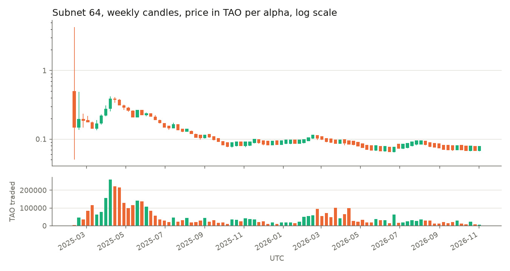
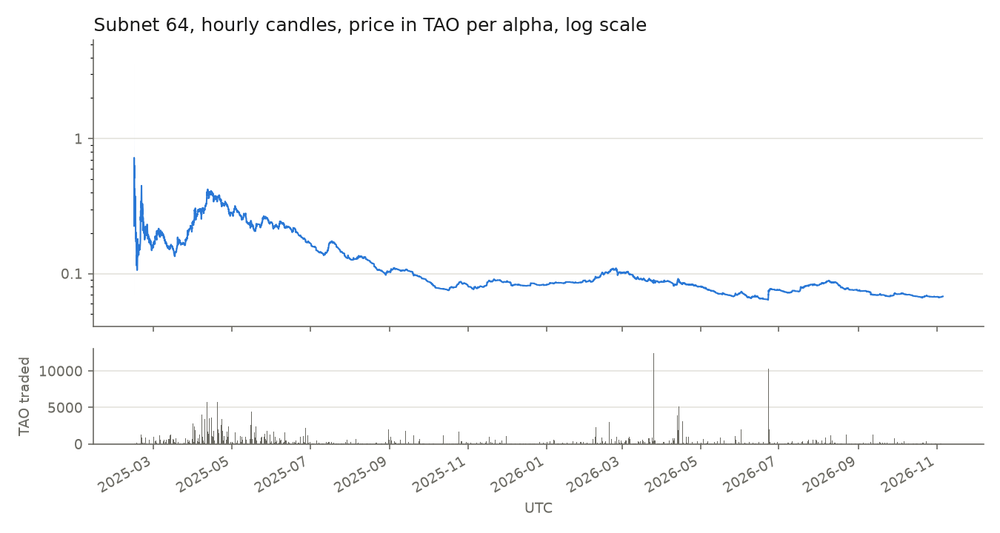

# Examples

## Subnet candles from the Taoswap API

`taoswap_candles.py` reads a subnet's candles from the public Taoswap API, with no key:
live as they form, or every one since the subnet's first.

```bash
python examples/taoswap_candles.py 64                         # subnet 64, 1-minute candles, live
python examples/taoswap_candles.py 64 --plot sn64.png         # the same, with a chart redrawn at each read
python examples/taoswap_candles.py 64 --resolution W --genesis --plot sn64_weekly.png
python examples/taoswap_candles.py 64 --resolution 60 --genesis --plot sn64_hourly.png --out sn64_hourly.csv
```

| Flag           | What it does                                                                            | Default |
| -------------- | --------------------------------------------------------------------------------------- | ------- |
| `--resolution` | Candle width: 1, 5, 15, 30, 60 or 240 minutes, `D` (a day) or `W` (a week, from Monday) | 1       |
| `--genesis`    | Every candle since the subnet's first, then stop                                        | live    |
| `--plot FILE`  | Draw the candles in a PNG file                                                          |         |
| `--out FILE`   | With `--genesis`, write the candles to a CSV file                                       |         |
| `--every S`    | Seconds between two reads when live                                                     | 15      |

A chart draws one candlestick per candle, green when the price rose, up to 300 of them;
beyond that, the close inside its high-low range. The TAO traded is below, and the price
axis turns logarithmic once the price has moved tenfold.

Subnet 64's weekly candles since dTAO's launch:



The same history, hourly:



In Python, `subnet_trading.taoswap.Taoswap` reads the candles and `plot_candles` draws
them. The API caches candles for 15 seconds and allows about 10 requests a second from
one address, so a classroom reads its live prices from the validator instead.
